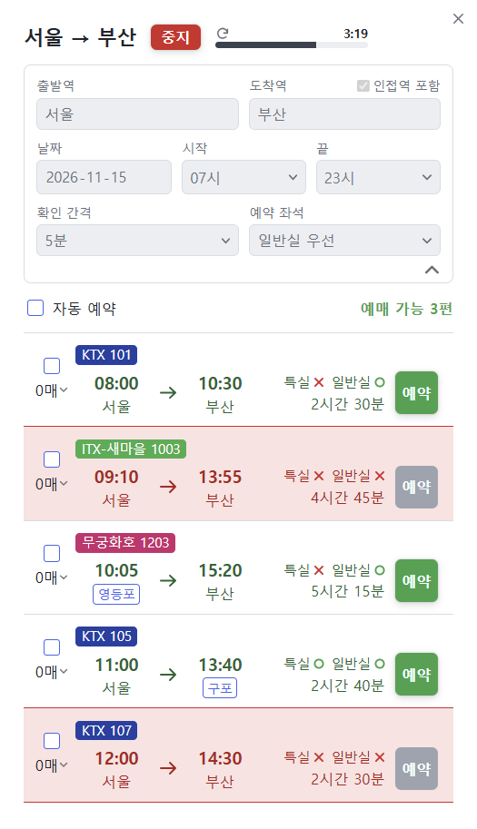
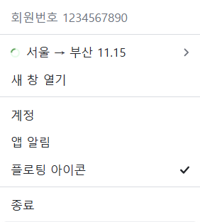
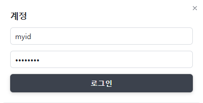
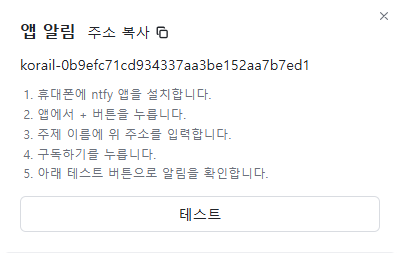
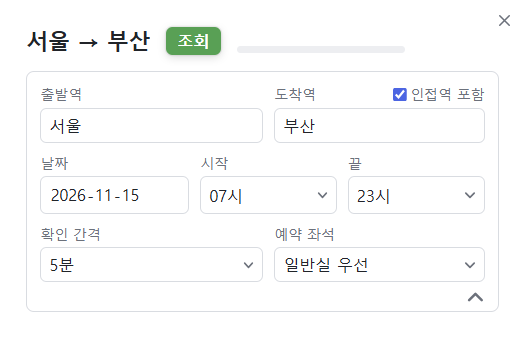
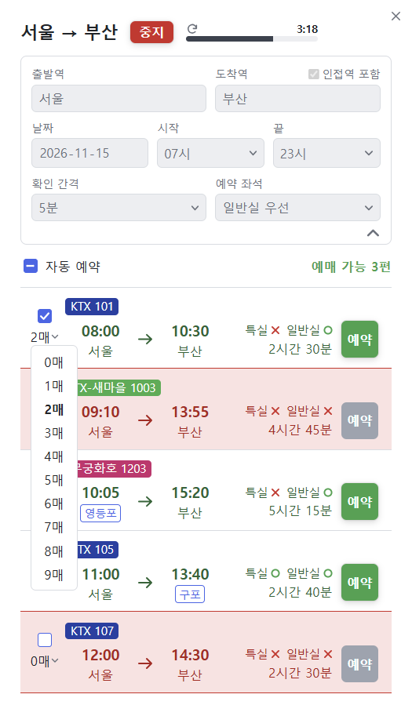
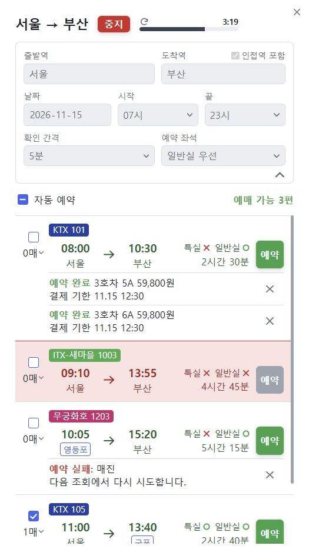
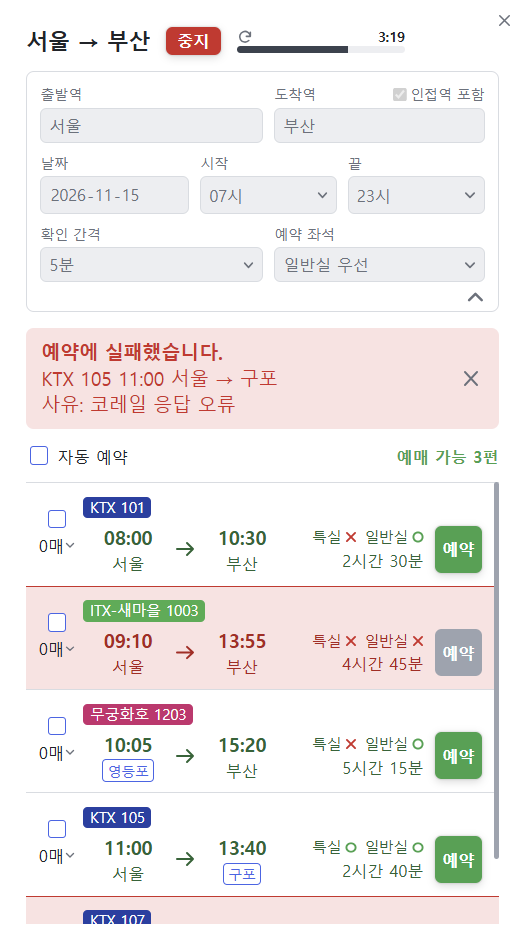
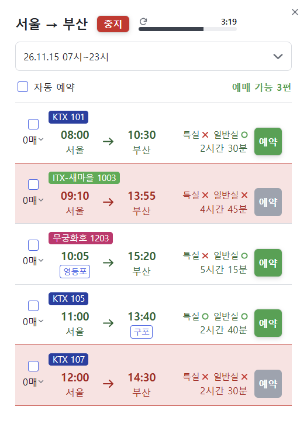
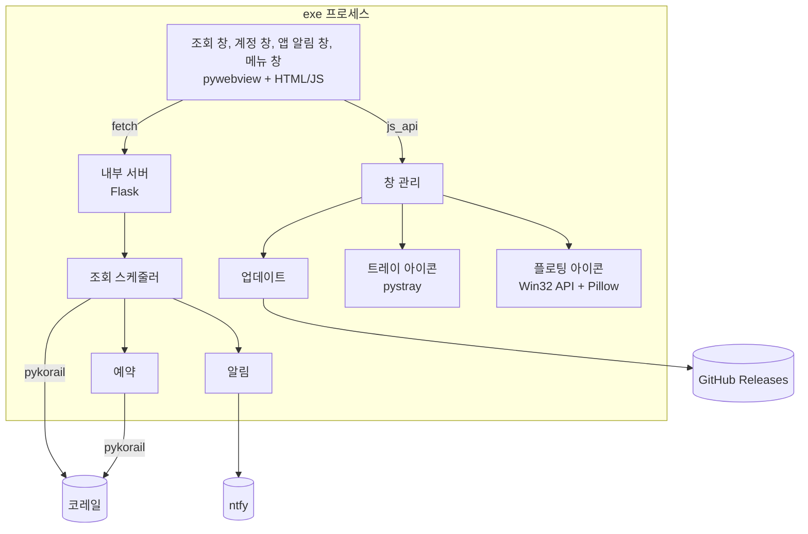

# 열차 조회 프로그램

코레일 열차의 빈자리를 정해진 간격으로 조회하고, 자리가 나면 알리고, 체크해 둔 열차를 자동으로 예약하는 Windows 프로그램입니다.  
트레이에 상주하므로 창을 닫아도 조회가 계속됩니다.

## 1. 소개

| 기능 | 내용 |
|---|---|
| 빈자리 조회 | 구간, 날짜, 시간대 조건으로 3~30분 간격 반복 조회 |
| 여러 조회 | 조건이 다른 조회 창을 여러 개 동시 실행 |
| 인접역 포함 | 출발역·도착역 근처 역의 열차를 함께 조회 |
| 알림 | 새로 자리가 나면 컴퓨터 알림, 소리, 창 깜빡임, 휴대폰 알림(ntfy) |
| 자동 예약 | 체크한 열차에 자리가 나면 지정한 매수만큼 예약 |
| 바로 예약 | 열차별 `예약` 버튼으로 1매 예약 |
| 플로팅 아이콘 | 화면 오른쪽 아래에서 조회 진행 상태 확인 |
| 자동 업데이트 | 새 버전이 있으면 메뉴에서 받아 교체 |

**예약까지만 합니다.**  
결제는 하지 않습니다.  
예약 후 결제 기한 안에 코레일 앱이나 홈페이지에서 직접 결제해야 합니다.

### 주의 사항

- 코레일의 공식 프로그램이 아닙니다.
- 코레일 정책이나 앱 변경으로 동작이 멈추거나, 조회 또는 계정 이용이 제한될 수 있습니다.
- 아이디와 비밀번호는 자동 로그인을 위해 이 컴퓨터의 `%APPDATA%\korail-watch`에 암호화 없이 저장됩니다.  
  다른 사람과 함께 쓰는 컴퓨터에서는 사용을 마친 뒤 로그아웃한 다음 이 폴더를 지우세요.
- 자리가 있는 열차를 체크해 두면 다음 조회 때 실제로 예약됩니다.
- 코레일에서 예약을 취소해도 프로그램은 알지 못합니다.  
  예약 완료 메시지는 `×`로 직접 지웁니다.

### 설치

| 항목 | 내용 |
|---|---|
| 운영체제 | Windows 10, 11 |
| 필요한 구성 요소 | Microsoft Edge WebView2 런타임 (Windows 11에는 기본 포함) |
| 받는 곳 | [최신 릴리스](https://github.com/KSJ0314/nextrail/releases/latest)의 `nextrail.exe` |

설치 과정은 없습니다.  
받은 파일을 원하는 폴더에 두고 실행합니다.  
서명되지 않은 파일이라 Windows SmartScreen 경고가 나올 수 있습니다.

## 2. 사용법

매진된 11월 15일 서울 → 부산 표를 취소표로 잡는 경우를 예로 듭니다.  
아래 화면의 계정, 열차, 예약 내용은 설명을 위한 가짜 데이터입니다.

### 2-1. 프로그램 켜기

exe를 실행하면 조회 창이 열리고 작업 표시줄 오른쪽 트레이에 기차 아이콘이 생깁니다.  
트레이 아이콘을 왼쪽이나 오른쪽 버튼으로 누르면 메뉴가 열립니다.

| 메뉴 | 내용 |
|---|---|
| 회원번호 | 로그인 상태 표시 |
| 조회 목록 | 누르면 해당 조회 창 열기, 돌아가는 원은 조회 중 표시 |
| 꺾쇠 아이콘 | 해당 조회의 시작·중지, 삭제 |
| 새 창 열기 | 새 조회 창 열기 |
| 계정 | 코레일 로그인, 로그아웃 |
| 앱 알림 | 휴대폰 알림 설정 |
| 플로팅 아이콘 | 플로팅 아이콘 켜기, 끄기 |
| 새 버전 업데이트 | 새 버전이 있을 때만 표시 |
| 종료 | 프로그램 끝내기 |

조회 창의 `×`는 프로그램을 끄지 않고 트레이로 숨깁니다.  
조회는 계속됩니다.

### 2-2. 로그인하기

**자동 예약과 `예약` 버튼을 쓰려면 로그인이 필요합니다.**  
조회와 알림만 쓴다면 건너뛰어도 됩니다.

트레이 메뉴의 `계정`에서 코레일 아이디와 비밀번호를 입력하고 `로그인`을 누릅니다.  
로그인에 성공하면 다음 실행부터 자동으로 로그인합니다.

### 2-3. 휴대폰 알림 받기 (선택)

자리를 비울 때 쓰는 기능입니다.  
컴퓨터 알림만으로 충분하면 건너뛰어도 됩니다.

트레이 메뉴의 `앱 알림`을 엽니다.

1. 휴대폰에 ntfy 앱을 설치합니다.
2. 앱에서 `+` 버튼을 누릅니다.
3. `주소 복사`로 복사한 주소를 앱의 `주제 이름`에 입력합니다.
4. `구독하기`를 누릅니다.
5. `테스트` 버튼으로 알림이 오는지 확인합니다.

알림 주소는 프로그램이 임의로 만듭니다.  
주소를 아는 사람은 누구나 알림을 볼 수 있으니 공유하지 마세요.

### 2-4. 조회 조건 넣기

조회 창에 조건을 넣습니다.

| 항목 | 내용 |
|---|---|
| 출발역, 도착역 | 직접 입력 또는 목록에서 선택 |
| 인접역 포함 | 근처 역에서 타고 내리는 열차도 함께 조회 |
| 날짜 | 출발 날짜 |
| 시작, 끝 | 출발 시간대, 시 단위 선택 |
| 확인 간격 | 3분, 5분, 10분, 15분, 30분 |
| 예약 좌석 | 일반실 우선, 일반실만, 특실 우선, 특실만 |

### 2-5. 조회 시작하기

제목 옆 `조회`를 누르면 바로 첫 조회를 하고, 이후 확인 간격마다 반복합니다.  
조회 중에는 입력칸이 잠기고 버튼이 `중지`로 바뀝니다.

| 표시 | 내용 |
|---|---|
| 게이지와 시간 | 다음 조회까지 남은 시간 |
| 새로고침 아이콘 | 조회 중일 때만 표시, 누르면 바로 새로 조회 |
| `예매 가능 3편` | 지금 자리가 있는 열차 수 |
| 파란 테두리 역 | 조건과 다른 인접역 |
| 특실, 일반실의 ○ × | ○ 자리 있음, × 자리 없음 |
| 빨간 바탕 줄 | 매진 |

목록은 출발 시간순입니다.

첫 조회에서 이미 자리가 있던 열차는 알리지 않습니다.  
그 뒤 **새로 자리가 난 열차만** 컴퓨터 알림, 소리, 창 깜빡임, 휴대폰 알림으로 알립니다.  
창을 누르면 깜빡임이 멈춥니다.

### 2-6. 예약하기

예약 방법은 두 가지입니다.

| 방법 | 쓰는 법 | 예약 시점 |
|---|---|---|
| 자동 예약 | 열차를 체크하고 매수 선택 | 조회가 새로 될 때 |
| 바로 예약 | 열차의 `예약` 버튼 | 누르는 즉시, 1매 |

자동 예약은 이렇게 동작합니다.

1. 열차를 체크하면 `1매`가 됩니다.  
   매수 목록에서 최대 `9매`까지 고를 수 있습니다.
2. 체크만으로는 예약하지 않습니다.  
   조회가 새로 될 때 체크한 열차에 자리가 있으면 예약합니다.  
   바로 시도하려면 새로고침 아이콘을 누릅니다.
3. 체크한 열차마다 매수만큼 1매씩 예약합니다.  
   체크한 열차가 여러 편이면 모두 예약합니다.  
   **한 편만 원하면 한 편만 체크하세요.**
4. 예약할 때마다 매수가 1씩 줄고, 0이 되면 체크가 빠집니다.
5. 매진으로 실패하면 체크와 남은 매수를 그대로 두고 다음 조회에서 다시 시도합니다.

`자동 예약` 체크박스는 목록의 모든 열차를 한 번에 체크하거나 풉니다.  
조회가 멈춰 있으면 자동 예약도 하지 않습니다.

예약이 끝나면 열차 아래에 건마다 메시지가 쌓입니다.  
실패하면 사유가 같은 자리에 나옵니다.

매진 외의 이유로 자동 예약에 실패하면 해당 열차의 체크가 빠지고, 위쪽에 오류 칸이 나옵니다.

메시지의 `×`는 화면의 메시지만 지웁니다.  
**코레일의 예약은 취소되지 않습니다.**  
예약 취소와 결제는 코레일 앱이나 홈페이지에서 합니다.  
취소한 열차를 다시 예약하려면 다시 체크합니다.

### 2-7. 창 정리하기

입력 카드 오른쪽 아래 화살표로 입력칸을 접을 수 있습니다.  
접은 카드는 어디를 눌러도 다시 펼쳐집니다.

조회 창의 가장자리와 모서리를 끌면 크기가 바뀌고, 글자와 칸이 함께 커지고 작아집니다.  
조건이 다른 조회는 메뉴의 `새 창 열기`로 추가합니다.

### 2-8. 플로팅 아이콘 보기

화면 오른쪽 아래 작은 원으로 조회 상태를 보여 줍니다.  
초록 원이 돌면 조회 중, 회색 원이면 진행 중인 조회가 없는 상태입니다.

마우스를 올리면 진행 중인 조회 목록이 펼쳐지고, 줄을 누르면 해당 조회 창이 열립니다.

트레이 메뉴의 `플로팅 아이콘`으로 끄고 켭니다.

### 2-9. 업데이트하기

새 버전이 있으면 트레이 메뉴에 `새 버전 X.Y.Z 업데이트`가 나옵니다.  
누르면 파일을 받아 검증한 뒤 프로그램이 다시 켜집니다.  
저장된 조회 조건과 설정은 유지됩니다.

## 3. 구현 방법

### 기술 구성

| 영역 | 사용 기술 | 역할 |
|---|---|---|
| 언어 | Python 3.12, HTML, CSS, JavaScript | |
| 코레일 통신 | [pykorail](https://github.com/devgyurak/pykorail) 0.6.0 | 열차 조회, 좌석 조회, 예약, 로그인 |
| 내부 서버 | Flask | 화면과 Python 사이의 REST API, `127.0.0.1`에서만 접속 가능 |
| 창 | pywebview (WinForms + WebView2) | 제목 표시줄 없는 창에 웹 화면 표시 |
| 트레이 | pystray | 트레이 아이콘, 컴퓨터 알림 |
| 플로팅 아이콘 | Win32 API (ctypes), Pillow | 픽셀별 투명도가 있는 창 직접 그리기 |
| 휴대폰 알림 | [ntfy](https://ntfy.sh) | HTTP POST로 알림 발송 |
| 패키징 | PyInstaller | exe 파일 하나로 묶기 |
| 배포 | GitHub Releases | exe와 SHA-256 체크섬 배포, 업데이트 확인 |

### 구조

화면은 웹 기술로 만들고, 같은 프로세스 안의 Flask 서버와 통신합니다.  
창 제어처럼 웹에서 할 수 없는 일은 pywebview의 `js_api`로 Python 메서드를 직접 부릅니다.

### 조회

스레드 하나에서 조회할 차례가 된 조건을 하나씩 처리합니다.  
pykorail 클라이언트를 여러 스레드에서 함께 써도 되는지 문서에 없어, 동시에 조회하지 않습니다.

1. 조회 차례인 조건 중 가장 오래 기다린 조건을 고릅니다.
2. 코레일 서버가 한 번에 한 쪽만 주므로, 마지막 열차의 출발 시간부터 이어서 최대 20쪽을 조회합니다.
3. 시간대 안의 열차를 출발 시간순으로 정렬합니다.
4. 지난번 결과와 비교해 새로 자리가 난 열차를 알립니다.  
   첫 조회는 비교 대상이 없어 기준만 저장합니다.
5. 체크한 열차를 예약합니다.
6. 다음 조회 시각을 정합니다.

새로고침은 다음 조회 시각을 0으로 바꿔 바로 차례가 되게 합니다.  
화면은 1초마다 서버에서 상태를 읽어 그립니다.

### 예약

| 단계 | 내용 |
|---|---|
| 좌석 찾기 | 객실 정보에서 `창측` 속성을 찾아 빈 창가 좌석 선택 |
| 지정 예약 | 찾은 좌석으로 예약 |
| 대체 | 창가 좌석이 없거나 코레일이 거절하면 코레일 배정 좌석으로 예약 |
| 재로그인 | 세션이 끊겼으면 다시 로그인해 한 번 더 시도 |

응답 코드 없는 오류는 예약이 이미 만들어졌을 수 있어, 중복을 막기 위해 다시 시도하지 않습니다.  
자동 예약과 `예약` 버튼이 같은 열차를 함께 예약하지 않도록 예약은 한 번에 하나씩 실행합니다.  
버튼을 누르고 기다리는 동안 자동 예약이 먼저 성공하면 버튼 쪽 예약은 하지 않습니다.  
결제 기능은 호출하지 않습니다.

### 알림

| 수단 | 구현 |
|---|---|
| 컴퓨터 알림 | pystray 트레이 알림 |
| 소리 | Web Audio API |
| 창 깜빡임 | CSS 애니메이션 |
| 휴대폰 | ntfy에 JSON POST, 한글 제목이 깨지지 않도록 헤더 대신 본문 사용 |

ntfy 주제는 UUID로 임의 생성합니다.  
계정 없이 쓸 수 있습니다.

### 저장

| 값 | 위치 |
|---|---|
| 조회 조건, 로그인 정보, 알림 주제, 플로팅 아이콘 설정 | WebView2 localStorage (`%APPDATA%\korail-watch`) |
| 조회 결과, 체크, 매수, 예약 메시지 | 메모리, 프로그램을 끄면 사라짐 |

localStorage는 주소별로 저장되므로 내부 서버는 고정 주소 `http://127.0.0.1:5050`을 씁니다.

### 창과 화면

- **제목 표시줄 없는 창:** Windows 기본 크기 조절이 동작하지 않아, 가장자리에 손잡이를 두고 끌기를 직접 계산합니다.
- **숨긴 창:** pywebview의 `resize`, `move`는 숨긴 창을 다시 보이게 해서, 크기와 위치는 `SetWindowPos`로 바꿉니다.
- **트레이 메뉴:** Windows 기본 메뉴로는 이 화면을 만들 수 없어, 왼쪽·오른쪽 클릭에 HTML 창을 엽니다.
- **크기:** 가장 바깥 창만 픽셀로 정하고 안쪽은 모두 `cqi`, `em` 비율이라, 창 크기에 따라 함께 커지고 작아집니다.
- **입력 부품:** 시간, 간격, 좌석, 역, 매수 목록과 스크롤 막대는 기본 부품 대신 직접 그렸습니다.

### 플로팅 아이콘

WebView2는 투명 창을 제대로 지원하지 않아, Win32 API로 직접 만듭니다.

1. `WS_EX_LAYERED` 창을 만듭니다.
2. 프레임마다 Pillow로 원과 목록을 투명 배경 이미지로 그립니다.
3. `UpdateLayeredWindow`로 픽셀별 투명도를 적용해 내보냅니다.
4. 완전히 투명한 픽셀은 마우스를 받지 못하므로, 아이콘 자리에 눈에 보이지 않는 불투명도 1을 깝니다.

창 크기를 고정하고 안쪽 그림만 바꿔, 펼칠 때 창이 흔들리지 않습니다.

### 자동 업데이트

1. 시작할 때 GitHub API로 최신 릴리스를 확인합니다.
2. 현재 버전보다 새로우면 메뉴에 항목을 표시합니다.
3. 누르면 exe를 받아 SHA-256을 체크섬 파일과 비교합니다.  
   다르면 지우고 기존 파일을 유지합니다.
4. 실행 중인 exe는 덮어쓸 수 없어, 교체용 bat을 띄우고 프로그램을 끝냅니다.
5. bat이 파일이 풀릴 때까지 최대 30초 교체를 시도한 뒤 다시 실행합니다.  
   실패하면 기존 exe를 다시 실행합니다.

### 배포

PyInstaller로 exe 파일 하나를 만들어 GitHub Release에 올립니다.  
GitHub가 파일 이름의 한글을 지우기 때문에, 올리는 파일 이름은 `nextrail.exe`입니다.  
체크섬은 `nextrail.exe.sha256`으로 함께 올립니다.

이 저장소에는 배포 파일과 문서만 있습니다.
